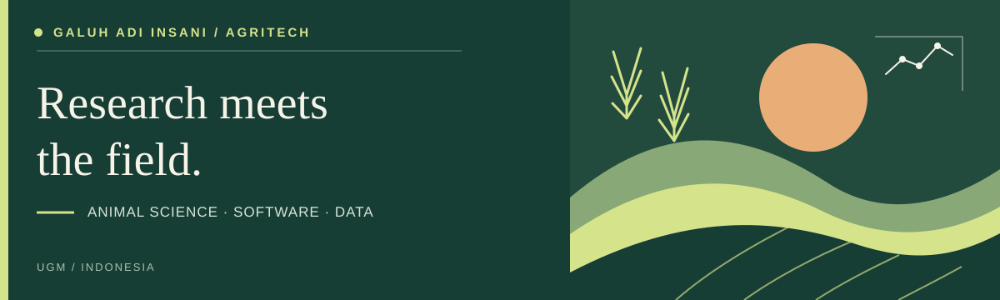

  
  
  

# 🌾 Galuh Adi Insani

**Research Software Engineer · AgriTech · Animal Science**

> *Ir. Galuh Adi Insani, S.Pt., M.Sc., IPM.*  
> Faculty of Animal Science, Universitas Gadjah Mada (UGM)

---

### 📌 About Me

I build research software for **livestock nutrition**, **farm management**, and **agricultural data analysis**. My work connects animal science with practical tools for researchers, educators, farmers, and industry teams.

  <a href="#featured-agritech-projects">📂 Featured Projects</a> ·
  <a href="#what-i-work-on">💡 Expertise</a> ·
  <a href="#articles-on-livestock-and-agriculture">📝 Articles</a> ·
  <a href="#research-profiles-and-collaboration">🤝 Get in Touch</a>

---

## 🚀 Featured AgriTech Projects

> *Practical applications at the intersection of livestock production, research, and software.*

| # | Project | Description | Tech Stack |
|:-:|:--------|:------------|:-----------|
| 01 | **[Ransum Ruminansia →](https://www.adioranye.my.id)** | Feed ration formulation for cattle, goats, and sheep with cost optimization using linear programming | `Python` `NumPy` `SciPy` |
| 02 | **[Adioranye AI →](https://www.adioranye.my.id/ai)** | Applied AI workspace for livestock data analysis and research support | `AI/ML` `TensorFlow` |
| 03 | **[smartdairy-hub →](https://github.com/adiorany3/smartdairy-hub)** | Comprehensive dairy farm management system | `JavaScript` `React` |
| 04 | **[sembako-dashboard →](https://github.com/adiorany3/sembako-dashboard)** | Dashboard for staple food supply and agricultural market data | `Python` `Streamlit` |

---

### 📚 More Research & Development

Explore research tools and repositories

| Repository | Description |
|:-----------|:------------|
| [CitChat](https://github.com/adiorany3/CitChat) | Citation management |
| [LandPage](https://github.com/adiorany3/LandPage) | Web development |
| [ObjectDetection](https://github.com/adiorany3/ObjectDetection) | Computer vision |
| [DeteksiSuara](https://github.com/adiorany3/DeteksiSuara) | Audio analysis |
| [inbreed](https://github.com/adiorany3/inbreed) | Genetic analysis |
| [AdIoranye](https://github.com/adiorany3/AdIoranye) | Automation tools |
| [ChatSecrets](https://github.com/adiorany3/ChatSecrets) | Secure communication |
| [statistika](https://github.com/adiorany3/statistika) | Statistical tools |
| [SumberYAML](https://github.com/adiorany3/SumberYAML) | Data management |
| [bbternak](https://github.com/adiorany3/bbternak) | Livestock weight tracking |

📂 **[Browse all GitHub repositories →](https://github.com/adiorany3?tab=repositories)**

---

## 💡 What I Work On

| Focus Area | Application |
|:-----------|:------------|
| 🐄 **Livestock Nutrition** | Feed formulation, ingredient databases, and cost optimization |
| 🏠 **Farm Management** | Recording systems, monitoring dashboards, and decision support |
| 📊 **Scientific Computing** | ANOVA, regression, reproducible workflows, and data visualization |
| 🤖 **Applied AI** | Computer vision, predictive modeling, and agricultural automation |
| 🌡️ **Smart Farming** | Sensor systems and environmental monitoring |

> *Research interests include animal genetics, bioinformatics, and livestock production data.*

---

## 📝 Articles on Livestock & Agriculture

> Notes on livestock production, animal health, feed optimization, and agricultural technology.

<!-- BLOG-POST-LIST:START -->
- 📰 [Sepuluh Ribu Sapi Bali, Berapa yang Layak Berangkat?](https://catataninsani.wordpress.com/2026/10/29/artikel-blog-sepuluh-ribu-sapi-bali-berapa-yang-layak-berangkat/) — *29 Oktober 2026*
- 📰 [Agam Menunggu Pakan, Berapa Lama Stok Kandang Bertahan?](https://catataninsani.wordpress.com/2026/10/28/artikel-blog-agam-menunggu-pakan-berapa-lama-stok-kandang-bertahan/) — *28 Oktober 2026*
- 📰 [Obat Ternak Tiba di Agam, Kapan Hasilnya Aman Dijual?](https://catataninsani.wordpress.com/2026/10/27/artikel-blog-obat-ternak-tiba-di-agam-kapan-hasilnya-aman-dijual/) — *27 Oktober 2026*
- 📰 [Setelah Sapi Diinseminasi, Kapan Ongkos Menunggu Mulai Membesar?](https://catataninsani.wordpress.com/2026/10/26/artikel-blog-setelah-sapi-diinseminasi-kapan-ongkos-menunggu-mulai-membesar/) — *26 Oktober 2026*
- 📰 [Kandang Baru Sumut Perlu Ruang untuk Sapi yang Belum Boleh Bercampur](https://catataninsani.wordpress.com/2026/10/25/artikel-blog-kandang-baru-sumut-perlu-ruang-untuk-sapi-yang-belum-boleh-bercampur/) — *25 Oktober 2026*
<!-- BLOG-POST-LIST:END -->

📖 [Read all articles](https://catataninsani.wordpress.com/) · 📡 [Subscribe via RSS](https://catataninsani.wordpress.com/feed/)

---

## 🛠️ Tools and Technologies

### Programming Languages

  
  
  

### Data Science & AI

  
  
  
  
  

### Web Development

  
  
  
  
  

---

## 🤝 Research Profiles and Collaboration

Interested in collaborating on **animal science research**, **agricultural data analysis**, or **AgriTech software**? Let's connect!

### 📧 Contact
| Platform | Link |
|:---------|:-----|
| ✉️ Email | [adioranye@ugm.ac.id](mailto:adioranye@ugm.ac.id) |
| 💼 LinkedIn | [Galuh Adi Insani](https://www.linkedin.com/in/galuh-adi-insani-1aa0a5105/) |
| ✈️ Telegram | [@adioranye](https://t.me/adioranye) |

### 🎓 Research Profiles
| Platform | Link |
|:---------|:-----|
| 🎓 UGM Academic | [Profile](https://acadstaff.ugm.ac.id/galuhadiinsani) |
| 📚 Google Scholar | [Publications](https://scholar.google.com/citations?user=8y2L7xoAAAAJ&hl=en) |
| 🔬 SINTA | [Research Profile](https://sinta.kemdiktisaintek.go.id/authors/profile/5972626/?view=researches) |
| 📈 Kaggle | [adioranye](https://www.kaggle.com/adioranye) |

---

## 🙏 Acknowledgments

Special thanks to **PT Dahono Consulting Agency** for supporting the development of open-source projects since October 2026.

  

